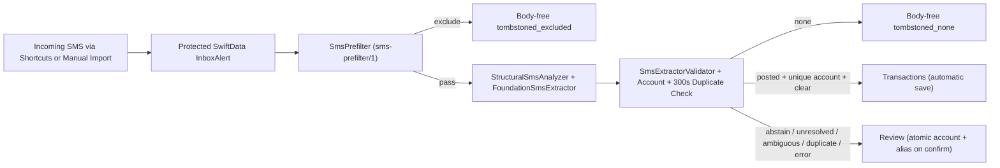

# Pocket Financer — iOS

[](https://github.com/pocket-financer/pocket-financer-ios/actions/workflows/ci.yml)
[](https://developer.apple.com/ios/)
[](https://www.swift.org/)
[](https://developer.apple.com/xcode/swiftui/)
[](https://developer.apple.com/documentation/foundationmodels)

Pocket Financer is a local-first personal finance tracker for iPhone. A user-created Shortcuts automation hands incoming financial alerts to `Import Transaction Alert`, which durably stores them in protected SwiftData, filters unambiguous non-financial alerts, extracts structured transaction fields on device with Apple Foundation Models, validates every Unicode-scalar span deterministically, and automatically saves verified transactions or retains exceptions for Review.

Alerts, prompts, model outputs, and transactions never leave the device. There is no server backend, analytics SDK, ad SDK, cloud sync, networking client, or third-party Swift package dependency.

> [!IMPORTANT]
> Automatic Message ingestion remains experimental until the full Shortcuts payload and locked-device matrix passes on a physical iPhone (see [docs/device-validation.md](docs/device-validation.md)). Manual local import remains supported. Direct iOS Messages database access is intentionally out of scope.

## Consolidated SMS pipeline (`pocketfinancer.sms-pipeline/1`)

1. **Admit before inference (`AlertIngestionService` + `ImportTransactionAlertIntent`):** Saves an immutable `InboxAlert` inside `NSFileProtectionCompleteUntilFirstUserAuthentication` storage (excluded from backups) and links sender-independent identical bodies arriving within 15 seconds.
2. **Prefilter (`SmsPrefilter`):** Runs `sms-prefilter/1` against only the immutable SMS body before model work. Empty texts, digit-less messages, gaming promos, OTP codes, collect/mandate requests, telecom notices, brokerage EOD reports, and texts with no financial cues become body-free `tombstoned_excluded` records (`rawBody = ""`).
3. **Advisory analysis (`StructuralSmsAnalyzer`):** Records deterministic clause boundaries, currency amounts, cues, and candidate spans (`pocketfinancer.sms-analysis/2`) as untrusted advice for the extractor input (`pocketfinancer.sms-extractor-input/1`).
4. **On-device extraction (`FoundationSmsExtractor`):** Invokes `SystemLanguageModel.default` with `prompts/apple-fm-sms-extractor.txt` and an 18-field `@Generable` flat schema (`schemas/apple-fm-flat.schema.json`), projecting deterministically into canonical `pocketfinancer.sms-extractor/1` JSON.
5. **Host validation (`SmsExtractorValidator`):** Enforces a single JSON object (rejecting duplicate keys, floats, and trailing content), Unicode-scalar bounds and exact text equality, exact `Int64` minor units, ISO-4217 currency markers, grounded debit/credit cues, normalized masked account or VPA reference, and normalized counterparty.
6. **Account resolution, 5-minute duplicate window, and settlement (`SmsProcessingCoordinator` + `SmsProcessingStore`):**
   - `none` settles into a body-free `tombstoned_none` record with zero retained SMS text.
   - `abstain` or validation/runtime failure opens or updates an `SmsReviewCase` while retaining evidence.
   - `posted` with a unique confirmed `SmsAccountAlias` and clear of the 5-minute (`300` seconds) duplicate window `(accountID, direction, minorUnits, currency)` automatically persists `Transaction`, `SmsTransactionRevision`, and `.persisted` operation state.
   - `posted` with an unresolved/ambiguous account or a matching transaction within 300 seconds routes to `SmsReviewCase` (`account_resolution_unresolved`, `account_resolution_ambiguous`, or `duplicate_possible`). Confirming in Review atomically saves `Transaction` and links or creates the confirmed `Account` and `SmsAccountAlias`.



## Requirements & Local Setup

- macOS 26+ with Xcode 26+, targeting iOS 26+.
- An Apple Intelligence-capable physical iPhone for on-device Foundation Models generation checks (with iPhone and Siri languages aligned to supported English; phone Region may remain India).
- Optional `Config/Signing.local.xcconfig` (ignored by Git) with `DEVELOPMENT_TEAM` and `PRODUCT_BUNDLE_IDENTIFIER` for device builds. There are no Swift Package Manager dependencies to resolve.

## Verification

```sh
scripts/format.sh --lint
scripts/build.sh
scripts/test.sh
```

Synced canonical contracts, schemas, prompt, profiles, and golden test vectors live under `PocketFinancer/Resources/SmsProcessing/` (17 iOS assets + `release-manifest.json`) and `PocketFinancerTests/Fixtures/prefilter-vectors.json` (54 golden vectors). They are generated from [`pocket-financer-intelligence`](https://github.com/pocket-financer/pocket-financer-intelligence) via:

```sh
python ../pocket-financer-intelligence/scripts/sync_native_assets.py --check --target ios
```

Do not copy runtime code from [`pocket-financer-android`](https://github.com/pocket-financer/pocket-financer-android) or commit real personal SMS messages into this repository.

## Documentation

- [Architecture & processing transparency](docs/architecture.md)
- [Privacy and security](docs/privacy-and-security.md)
- [Shortcuts automation setup](docs/shortcuts-setup.md)
- [Physical-device validation](docs/device-validation.md)
- [CI, branching, and releasing](docs/releasing.md)
- [Agent and contributor invariants](AGENTS.md)
- [Contributing guide](CONTRIBUTING.md)
- [Security reporting policy](SECURITY.md)

## Copyright

Copyright © 2026 Manish Aradwad. All rights reserved. This repository is not open source at this time.
