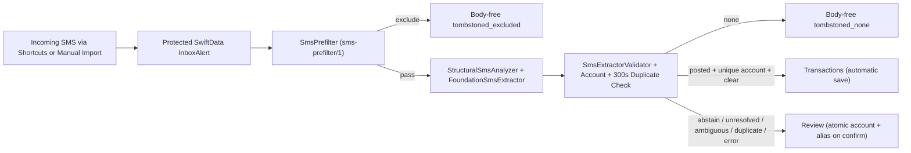

# Pocket Financer — iOS

[](https://github.com/ManishAradwad/pocket-financer-ios/actions/workflows/ci.yml)
[](https://developer.apple.com/ios/)
[](https://www.swift.org/)
[](https://developer.apple.com/xcode/swiftui/)
[](https://developer.apple.com/documentation/foundationmodels)

Pocket Financer is a local-first personal finance tracker for iPhone. A user-created Shortcuts automation hands incoming financial alerts to `Import Transaction Alert`, which durably stores them in protected SwiftData, filters obvious non-financial alerts, extracts structured fields on device with Apple Foundation Models, validates every span deterministically, and automatically saves verified transactions or retains exceptions for Review.

Alerts, prompts, model outputs, and transactions never leave the device. There is no server backend, analytics SDK, ad SDK, cloud sync, networking client, or third-party package dependency.

> [!IMPORTANT]
> Automatic Message ingestion remains experimental until the full Shortcuts payload and locked-device matrix passes on a physical iPhone. Manual local import remains supported. General SMS database access is intentionally out of scope on iOS.

## Consolidated SMS pipeline (`pocketfinancer.sms-pipeline/1`)

1. **Admit before inference:** Shortcuts `Import Transaction Alert` or Manual Import saves an immutable `InboxAlert` inside `NSFileProtectionCompleteUntilFirstUserAuthentication` storage (excluded from backups) and deduplicates identical bodies within 15 seconds.
2. **Prefilter (`SmsPrefilter`):** Inspects only the immutable SMS body before model work. Empty texts, digit-less messages, gaming promos, OTP codes, collect/mandate requests, telecom notices, brokerage EOD reports, and texts with no financial cues become body-free `tombstoned_excluded` records (`rawBody = ""`).
3. **Advisory analysis (`StructuralSmsAnalyzer`):** Records deterministic clause, currency, and candidate spans as untrusted advice for the model input (`pocketfinancer.sms-extractor-input/1`).
4. **On-device extraction (`FoundationSmsExtractor`):** Invokes `SystemLanguageModel.default` with `prompts/apple-fm-sms-extractor.txt` and `@Generable` 18-field guided flat output (`schemas/apple-fm-flat.schema.json`), projecting deterministically into canonical `pocketfinancer.sms-extractor/1` JSON.
5. **Host validation (`SmsExtractorValidator`):** Enforces a single JSON document (rejecting duplicate keys and trailing data), Unicode-scalar bounds/text equality, exact minor units (`Int64`), ISO-4217 currency markers, grounded debit/credit cues, normalized masked account or VPA reference, and normalized counterparty.
6. **Account, 5-minute duplicate, and settlement gate (`SmsProcessingCoordinator` + `SmsProcessingStore`):**
   - `none` -> settles into a body-free `tombstoned_none` record with zero retained SMS text.
   - `abstain` or validation/runtime failure -> opens or updates `SmsReviewCase` while retaining evidence.
   - `posted` with unique confirmed `SmsAccountAlias` and clear of the 5-minute (`300` seconds) duplicate window `(accountId, direction, minorUnits, currency)` -> automatically persists `Transaction`, `SmsTransactionRevision`, and `.persisted` operation state.
   - `posted` with unresolved/ambiguous account or a matching transaction within 300 seconds -> routes to `SmsReviewCase` (`account_resolution_unresolved`, `account_resolution_ambiguous`, or `duplicate_possible`). Confirming in Review atomically writes `Transaction` and creates/links confirmed `Account` + `SmsAccountAlias`.

## How it works



## Processing transparency and diagnostics

- **What Happened (`AlertProcessingDetailView`):** Shows the linked `Transaction` and `Account` (or Review/tombstone status), `DecisionTraceTimeline`, `SmsPersistenceDecision` checks, `SmsContractAssets.extractorPrompt()`, stored request/response from `SmsSelectorAttempt`, retry controls, and explicit iOS 26 Foundation Models API limits.
- **Run Synthetic Model Test (`ModelSelfTestService`):** Runs an in-memory synthetic alert through `SmsOperationSnapshotFactory` and `SmsProcessingCoordinator` with an `.unresolved` account resolver so it exercises prompts, generation, and validation while routing safely to Review without touching the user ledger.

## Requirements & Local Setup

- macOS 26+ with Xcode 26+, targeting iOS 26+.
- A physical Apple Intelligence-capable iPhone for Foundation Models generation checks (with iPhone and Siri languages aligned to supported English; phone Region may remain India).
- Optional `Config/Signing.local.xcconfig` with `DEVELOPMENT_TEAM` and `PRODUCT_BUNDLE_IDENTIFIER` for device builds. No SPM resolution step exists.

## Verification

```sh
scripts/format.sh --lint
scripts/build.sh
scripts/test.sh
```

Synced canonical contracts, schemas, prompts, profiles, and test vectors live under `PocketFinancer/Resources/SmsProcessing/` and `PocketFinancerTests/Fixtures/prefilter-vectors.json` (generated by `pocket-financer-intelligence/scripts/sync_native_assets.py --target ios`). Do not copy `pocket-financer-android` or real personal SMS into this repository.

## Copyright

Copyright © 2026 Manish Aradwad. All rights reserved. This repository is not open source at this time.
