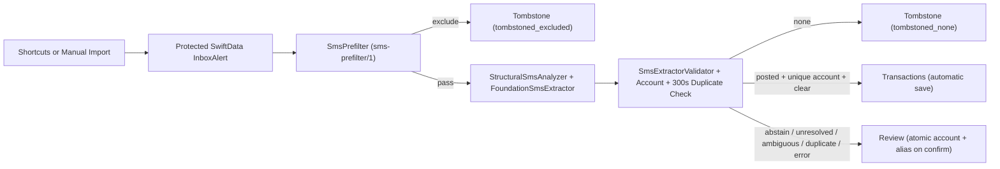

# Architecture & Processing Transparency

## System boundary and authority

Pocket Financer cannot read the iOS Messages database. A user-created Shortcuts automation passes incoming message content to `Import Transaction Alert` (`ImportTransactionAlertIntent`), which durably writes an immutable `InboxAlert` into protected SwiftData storage and returns promptly without waiting for inference. Manual local import (`ManualAlertImportView`) uses the same durable admission boundary.

Foreground processing executes the single canonical SMS pipeline contract (`pocketfinancer.sms-pipeline/1`) synced from [`pocket-financer-intelligence`](https://github.com/pocket-financer/pocket-financer-intelligence):

1. `SmsPrefilter` (`sms-prefilter/1`) evaluates only the immutable SMS body before model invocation and settles unambiguous non-financial messages into body-free `tombstoned_excluded` records (`rawBody = ""`).
2. `StructuralSmsAnalyzer` (`pocketfinancer.sms-analysis/2`) attaches deterministic clause boundaries, currency amounts, cues, and candidate spans as untrusted advisory evidence (`pocketfinancer.sms-extractor-input/1`). Advisory rules never act as an allowlist or semantic override.
3. `FoundationSmsExtractor` runs Apple Foundation Models (`SystemLanguageModel.default`) serialized by `FoundationModelExecutionGate` using `prompts/apple-fm-sms-extractor.txt` and the 18-field `@Generable` guided flat schema (`schemas/apple-fm-flat.schema.json`), then deterministically projects the output into canonical `pocketfinancer.sms-extractor/1` JSON.
4. `SmsExtractorValidator` treats every model response as untrusted and enforces a single JSON document (rejecting duplicate keys, floating-point numbers, and trailing content), Unicode-scalar span bounds and exact substring equality, exact `Int64` minor units, ISO-4217 currency markers, grounded debit/credit cues, normalized masked account or VPA references, and normalized counterparties.
5. `SmsProcessingCoordinator` and `SmsProcessingStore` run `GroundedAccountResolver`, check the 5-minute (`300` seconds) duplicate window, record the gate decision, and settle atomically.

## Routing and settlement

- **Automatic save:** Valid `posted` extractions that resolve to a unique confirmed `SmsAccountAlias` and clear the 5-minute (`300` seconds) duplicate window `(accountID, direction, minorUnits, currency)` atomically persist `Transaction`, `SmsTransactionRevision` (`automatic_grounded_extraction`), and `.persisted` operation state.
- **Review retention:** Unresolved, ambiguous, abstained, invalid, interrupted, failed, or 300-second duplicate extractions retain source evidence and open or update an `SmsReviewCase`. Confirming or correcting in Review (`ReviewCorrectionView` / `GroundedReviewCorrectionView`) atomically writes `Transaction`, links or creates the confirmed `Account` and `SmsAccountAlias`, and appends a hash-chained `SmsUserFeedbackEvent`.
- **Body-free tombstones:** Prefilter exclusions (`tombstoned_excluded`) and valid `none` extractions (`tombstoned_none`) erase `InboxAlert.rawBody` (`""`) and redact stored analysis and selector request text (`"{}"`).
- **Host-owned receipt time:** Transaction timestamps come from host-owned `platform_received` receipt time and are read-only in grounded Review.

## Codebase layers

| Layer | Directory | Core responsibilities |
| --- | --- | --- |
| App | `PocketFinancer/App/` | `PocketFinancerApp`, `StoreBootstrapView` fail-closed loading/recovery, `AppRootView`, `PrivacyShieldView`, `PendingAlertDrainPolicy` |
| Data | `PocketFinancer/Data/` | Versioned SwiftData schemas (`PocketFinancerSchemaV1`..`V7`), `AppDatabase`, `SecureStoreFilePolicy`, `SmsProcessingStore` (leases, fencing, trace/feedback hash chains, atomic settlement, projections), domain models |
| Domain | `PocketFinancer/Domain/` | `AccountNormalizer`, `AlertSourceIdentity`, `AlertProcessingDiagnostics` code presentation |
| Services | `PocketFinancer/Services/` | `AlertIngestionService`, `FoundationModelExecutionGate`, `LocalDataService`, `ModelDiagnostics`, `ModelSelfTestService`, and `SmsProcessing/` (`SmsContractAssets`, `SmsPrefilter`, `StructuralSmsAnalyzer`, `FoundationSmsExtractor`, `SmsExtractorValidator`, `GroundedAccountResolver`, `SmsProcessingCoordinator`, `SmsReviewProjection`, `SmsProcessingJSON`) |
| Intents | `PocketFinancer/Intents/` | Background-safe `ImportTransactionAlertIntent` durable inbox admission |
| Features | `PocketFinancer/Features/` | SwiftUI `Onboarding`, `Home`, `Transactions` (`ManualAlertImportView`, `AlertProcessingDetailView`, `DecisionTraceTimeline`, `ReviewCorrectionView`, `GroundedReviewCorrectionView`, `TransactionDetailView`), and `Settings` (`ModelSelfTestReportView`) |
| Shared | `PocketFinancer/Shared/` | `CurrencyFormatter`, `PrimaryCurrencySettings`, `ModelStatusView`, `TransactionRow`, `EmptyStateView` |
| Contract assets | `PocketFinancer/Resources/SmsProcessing/` | `release-manifest.json` + 17 SHA-256-verified iOS schemas, profiles, and Apple FM prompt |

## Processing transparency and durable audit records

Pocket Financer exposes owner-visible local audit records without fabricating private Apple model internals:

| Stage | Storage / Contract | Behavior |
| --- | --- | --- |
| Source admission | `InboxAlert` + `SmsSourceMetadataEvent` | Retained while pending, processing, review, or imported; body erased into `tombstoned_excluded` or `tombstoned_none` on terminal discard |
| Prefilter | `SmsPrefilter` (`sms-prefilter/1`) | Body-only exclusion before inference for empty, digit-less, gaming promo, OTP, collect/mandate, telecom, brokerage EOD, and non-financial texts |
| Advisory analysis | `SmsProcessingAnalysis` | Deterministic clauses, cues, and candidate spans supplied to the model as untrusted advice; redacted (`"{}"`) on `tombstoned_none` |
| Model attempt | `SmsSelectorAttempt` | Stores request JSON, completion status, safe error code, and raw projected output JSON; request redacted (`"{}"`) on `tombstoned_none` |
| Normalized result & gate | `SmsReconstructedResult` + `SmsPersistenceDecision` | Stores `pocketfinancer.processing-result/3` JSON and 11 gate checks (`rollout_mode: "automatic"`, `duplicate_assessment`, `account_resolution`) |
| Decision trace | `SmsProcessingTraceEvent` | Hash-chained ordered stages (`claim`, `prefilter`, `analysis`, `triage`, `selector_execution`, `selector_validation`, `account_resolution`, `reconstruction`, `persistence_gate`, `settlement`, `recovery`) |
| Ledger & revisions | `Transaction`, `SmsTransactionRevision`, `SmsUserFeedbackEvent` | Written atomically on automatic save or Review confirmation; subsequent ledger edits append new revisions without overwriting history |

### What Happened screen (`AlertProcessingDetailView`)

Displays the outcome summary, tombstone `retentionState` when discarded, linked `Transaction` and `Account` records, `DecisionTraceTimeline`, `SmsPersistenceDecision`, source evidence (or body-erased notice), verified `SmsContractAssets.extractorPrompt()`, `SmsSelectorAttempt` request/response, retry controls, and explicit iOS 26 Apple API limitations.

### Synthetic self-test (`ModelSelfTestService`)

**Settings → Run Synthetic Model Test** executes an in-memory synthetic alert (`INR 500.00` debit at `Demo Store`) through `SmsOperationSnapshotFactory` and `SmsProcessingCoordinator` with an `.unresolved` account resolver. It verifies contract assets, locale check, guided generation, and host validation while routing safely to Review without touching the user ledger.

### Apple Foundation Models API limitations

Apple's public iOS 26 Foundation Models API does not expose hidden reasoning, a stable owner-readable model build, per-request input/output token counts, tokens per second, numeric context-window size, KV-cache state, or confidence/logits. Pocket Financer reports these metrics as unavailable rather than estimating them.

## Provenance, schema migrations, and cross-repo sync

- **Runtime provenance:** Every `SmsOperationConfiguration` records `model_identity_kind: "system_managed_runtime"`, `model_file_sha256: null`, `wire_transport: "apple_fm_guided_flat"`, `grammar_enabled: false`, `grammar_sha256: null`, OS/runtime version, and SHA-256 digests verified from `release-manifest.json` (`SmsContractAssets.verify()`).
- **Schema migrations:** Consecutive lightweight migrations across `PocketFinancerSchemaV1`..`V7` preserve existing stores without fabricating missing historical audit fields. Pre-V5 transactions receive an idempotent `SmsLegacyTransactionSnapshot` and revision `0` (`legacy_current_state_original_history_unknown`).
- **Cross-repo contract sync:** `pocket-financer-intelligence/scripts/sync_native_assets.py --target ios` syncs `release-manifest.json` (19 total cross-platform artifacts), the 17 iOS-bundled assets under `PocketFinancer/Resources/SmsProcessing/`, and the 54 golden vectors in `PocketFinancerTests/Fixtures/prefilter-vectors.json`. [`pocket-financer-android`](https://github.com/pocket-financer/pocket-financer-android) consumes the Android target of the same release manifest.
