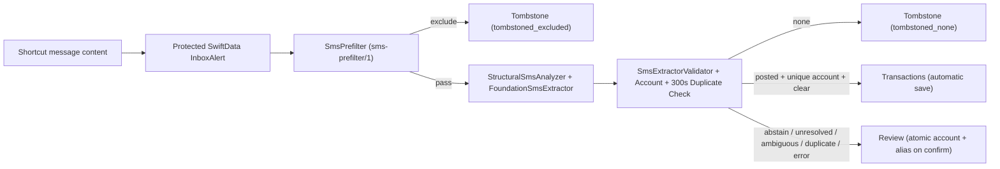

# Architecture

## Authority and system boundary

Pocket Financer cannot read the iOS Messages database. A user-created Shortcuts
automation passes message content to `Import Transaction Alert`, which writes a
protected SwiftData `InboxAlert` record and returns promptly. Foreground processing
then executes the single canonical SMS pipeline contract (`pocketfinancer.sms-pipeline/1`)
synced from `pocket-financer-intelligence`.

`SmsPrefilter` (`sms-prefilter/1`) runs before model work and converts unambiguous
non-financial messages into body-free `tombstoned_excluded` records (`rawBody = ""`).
For remaining candidates, `StructuralSmsAnalyzer` attaches advisory cues/spans,
`FoundationSmsExtractor` runs Apple Foundation Models using the 18-field guided flat
schema (`apple-fm-flat.schema.json`), and `SmsExtractorValidator` enforces one JSON
object, Unicode-scalar bounds/text equality, ISO-4217 currency markers, grounded
direction cues, exact `Int64` minor units, and normalized account/counterparty references.

## Routing and settlement

- Valid `posted` extractions that resolve to a unique confirmed `SmsAccountAlias` and clear
  the 5-minute (`300` seconds) duplicate check automatically persist `Transaction`,
  `SmsTransactionRevision`, and `.persisted` operation state.
- Unresolved, ambiguous, abstained, invalid, interrupted, failed, or 300-second duplicate
  extractions retain source evidence and create or reuse an `SmsReviewCase`. Confirming
  or correcting in Review atomically saves the `Transaction`, creates or links the
  `Account` and confirmed `SmsAccountAlias`, and records revision-bound `SmsUserFeedbackEvent`.
- Valid `none` and prefilter-excluded operations erase sensitive SMS text into body-free
  tombstones (`tombstoned_none`, `tombstoned_excluded`).
- Stored historical SwiftData schemas V1–V7 migrate safely forward without inventing
  missing historical audit fields.

## Layers

- `Data`: versioned SwiftData schema (`PocketFinancerSchemaV1..V7`), protected store setup,
  `SmsProcessingStore`, review/feedback/tombstone persistence, and file protection policy.
- `Domain`: currency formatting, account/source identity normalization, and diagnostics code mapping.
- `Services`: `SmsContractAssets`, `SmsPrefilter`, `StructuralSmsAnalyzer`,
  `FoundationSmsExtractor`, `SmsExtractorValidator`, `GroundedAccountResolver`,
  `SmsProcessingCoordinator`, `AlertIngestionService`, `ModelSelfTestService`, and erasure.
- `Intents`: background-safe `ImportTransactionAlertIntent` durable inbox admission.
- `Features`: SwiftUI onboarding, Home, Transactions, `ReviewCorrectionView` /
  `GroundedReviewCorrectionView`, Settings, and simplified `AlertProcessingDetailView`.

## Provenance and erasure

For Apple Foundation Models provenance, iOS records `system_managed_runtime` with
`model_file_sha256: null`, `wire_transport: "apple_fm_guided_flat"`,
`grammar_enabled: false`, `grammar_sha256: null`, plus runtime, OS, prompt, and validation
profile digests verified from `release-manifest.json`. Erase All Local Data invalidates
active processing claims before removing pipeline models, transactions, accounts, and alerts.
